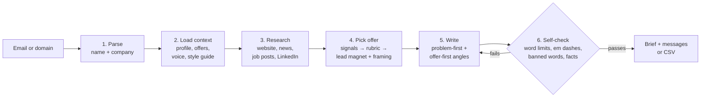

# ai-outreach-agent

**Give it an email or a domain and it researches the company, picks the offer most likely to get a reply, and writes a cold email and a LinkedIn DM that pass a word-count and style check.**

A Claude Code agent skill by [Zinkwonri Kayinu](https://github.com/zinkwonri-kayinu). I run it on my own outbound.

| | |
|---|---|
| **Input** | One or more emails (`jane@acme.com`) or domains (`acme.com`) |
| **Output** | Research brief, chosen offer + runner-up, 2 email angles, a LinkedIn DM, optional CSV |
| **Runs in** | [Claude Code](https://claude.com/claude-code) as a skill (no API keys, no servers) |
| **Time per prospect** | About 2-4 minutes, including research |
| **Real-world use** | 20 prospects across 2 batches in its first week |

---

## The problem

Good cold outreach needs three things that rarely happen together at volume:

1. **A real reason to reach out**: a funding round, a job post, a new exec, a product launch. Finding it means 10-15 minutes of research per prospect.
2. **The right offer**: an SDR team needs accounts, a Clay-heavy team needs a credit audit, an engineer needs to see working code. One generic pitch fits none of them.
3. **Copy that doesn't read like AI**: short, specific, no "leverage" or "seamless", no em dashes.

Templates give you speed and lose (1) and (2). Hand-writing keeps the quality but caps you at maybe 15 a day. This skill keeps both.

## How it works



### 1. Parse
It splits the email into a guessed name (`jane.doe` becomes Jane Doe) and a company domain. It skips junk lines (blank, `undefined`) and treats generic inboxes like `info@` as domain-only. For domain-only input it picks the contact by company size: founder under 30 people, head of growth/sales from 30-200, RevOps/sales ops above that.

### 2. Load context
Before writing anything it reads four files, so updating your results or rules never means editing the skill itself:

| File | What it controls |
|---|---|
| [`context/profile.md`](skill/context/profile.md) | Who's sending and which real results it may cite. **The only source for credibility claims**, so it can't invent a stat. |
| [`references/offers.md`](skill/references/offers.md) | 10 lead magnets × 5 framings, plus a rubric mapping signals to offers |
| [`references/voice.md`](skill/references/voice.md) | Message structures, word limits, sign-off, allowed asks |
| [`context/style-guide.md`](skill/context/style-guide.md) | The anti-AI-slop rules: banned patterns and word swaps |

### 3. Research
It runs 6-12 lookups: the company website (product, pricing, customers, careers), web searches for funding, hiring, news and tech stack, and optionally LinkedIn through the user's own browser, **read-only**. It stops once it has one or two specific, true hooks. Anything it can't find is written as "not found", never guessed.

### 4. Pick the offer
This is the core of the skill. Instead of one pitch for everyone, it matches what it found to an offer:

| Signal found | Offer it leads to | Framing |
|---|---|---|
| Hiring SDRs / running outbound | 100-account sample list | Making money |
| Clay in the stack | Clay table teardown | Saving credits |
| Product bought at a trigger moment | Buying-signal playbook | New mechanism |
| Technical founder or engineer | Small working build | Proof of work |
| Agency selling outbound | Sample list for one of *their* clients | Making money |

There are 10 lead magnets and 5 framings ([full rubric](skill/references/offers.md)). It picks one of each, names a runner-up, and says why the runner-up lost, so you can check its reasoning.

### 5. Write two angles
- **Problem-first**: names something specific it saw at their company, then offers the fix.
- **Offer-first**: leads with what it'll build, then one credibility line matched to their industry (a fintech gets the funding-outbound result, a Clay-heavy team gets the qualification result).

Each angle gets an email under 80 words and a LinkedIn DM under 40.

### 6. Self-check
Before output, every message is checked for word counts (counted, not estimated), em dashes, banned words (leverage, streamline, seamless...), rhetorical patterns (rule of three, "it's not X, it's Y"), and a detail that could only belong to this prospect. Failures get rewritten, not just reported.

For batches, [`scripts/export-csv.js`](skill/scripts/export-csv.js) enforces the same rules in code. **It refuses to write the CSV** if any message breaks one:

```text
$ node skill/scripts/export-csv.js bad.json out.csv
Not written. Fix these first:
- Test: message_1 contains an em dash
- Test: message_1 uses banned word "leverage"
```

## Example output

See [`examples/sample-run.md`](examples/sample-run.md) for a full single-prospect run (fictional company), and [`examples/sample-output.csv`](examples/sample-output.csv) for the batch CSV format.

Short version, for a RevOps lead whose team is hiring SDRs and who posted about list-building eating their day:

> **Subject:** lists for ledgerline sdrs
>
> Hi Priya,
>
> You mentioned your SDRs spend half their day building lists. With three more joining in Austin, that cost grows fast.
>
> I can build a sample of 100 SaaS companies that just launched AI credits or usage pricing, enriched in Clay with the RevOps and finance contacts, ready to load into HubSpot.
>
> Want me to send it over?

## Install

1. Install [Claude Code](https://claude.com/claude-code).
2. Copy the `skill/` folder into your skills directory:
   ```bash
   # macOS / Linux / Git Bash
   cp -r skill ~/.claude/skills/prospect-outreach
   ```
3. Replace `~/.claude/skills/prospect-outreach/context/profile.md` with your own name, results and tools.
4. (Optional) Install [Claude in Chrome](https://claude.com/chrome) for read-only LinkedIn research.

## Use

In Claude Code:

```text
/prospect-outreach jane@acme.com
```

or just ask in plain English:

```text
write outreach for these prospects and save a CSV to my downloads:
jane@acme.com
sam@globex.io
initech.com
```

Batch CSV columns: `full_name, email, subject_1, message_1, subject_2, message_2, linkedin_dm`.

## Design decisions

- **Context lives in files, not the prompt.** Results, offers and style rules are separate markdown files, read fresh every run. A new case study is a one-line edit.
- **Credibility is sourced, not generated.** The skill can only cite results in `profile.md`. That's the main guard against an AI writer inventing a "300% lift".
- **Two angles, not one.** Problem-first works when research finds a sharp hook. Offer-first works when it doesn't. Having both makes A/B testing easy.
- **Flags instead of guesses.** If it can't confirm a first name, it opens with "Hi," and flags the row. If the contact doesn't own pipeline (an engineer, a people leader), it changes the offer and says so.
- **Hard rules are enforced in code.** Language models are bad at counting words, so the batch exporter checks limits deterministically.

## Repo layout

```text
skill/                      ← copy this into ~/.claude/skills/prospect-outreach
  SKILL.md                  the workflow Claude follows
  references/offers.md      10 lead magnets, 5 framings, signal→offer rubric
  references/voice.md       message structures and hard rules
  context/profile.md        sender profile (replace with yours)
  context/style-guide.md    anti-AI-slop rules
  scripts/export-csv.js     batch CSV export with rule enforcement
examples/
  sample-run.md             full single-prospect output
  sample-rows.json          exporter input format
  sample-output.csv         exporter output
```

## License

MIT
